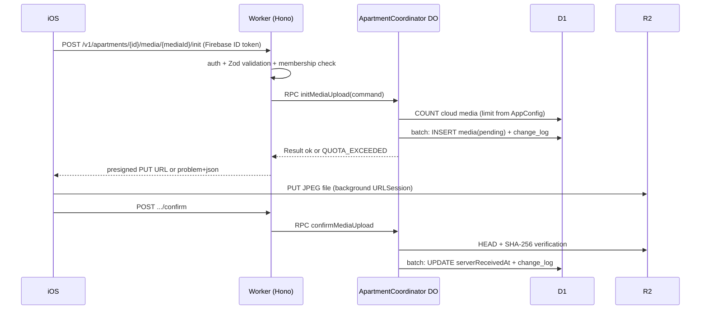
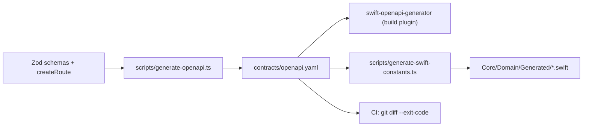

# StanMieszkania - Architecture (MVP)

> Status: Agreed in a grill-me session (19 decisions). This document extends [domain.md](domain.md). Architecture overrides relative to the initial domain draft: `SwiftData -> SQLiteData` (A13) and `Queues/Cron -> Durable Objects + Alarms` (A17).

## 1. Architecture Decision Register

| # | Area | Decision | Consequences |
|---|---|---|---|
| A1 | Languages | Backend uses 100% TypeScript. iOS uses Swift. | Two languages. API contract generates from TypeScript (A3). |
| A2 | Repository | Monorepo with `/backend` (pnpm workspace), `/ios` (Xcode + local SPM), and `/contracts/openapi.yaml`. | One contract change fits in one PR. |
| A3 | Contract | Zod is the single schema source. `@hono/zod-openapi` (`createRoute`) generates `openapi.yaml`. `swift-openapi-generator` generates the Swift client. | Prevents contract drift between backend and iOS. |
| A4/A5 | D1 Database | Raw D1 with a custom typed wrapper: `*.table.ts` (`as const` names + Zod row schema) and `*.queries.ts` (named queries). `query()` always parses rows through Zod. Migrations use `wrangler d1 migrations`. CI tests row schemas against `PRAGMA table_info`. | Zero ORM overhead, full type safety, zero magic strings. |
| A6 | Backend | Vertical slices per module: `domain/` (pure TS) -> `application/` (one file per use case) -> `infrastructure/` -> `http/`. `eslint-plugin-boundaries` enforces layer isolation. | Small files and a pure testable domain layer. |
| A7 | Errors | Custom `Result<T, E>` type. Domain errors form a discriminated union with constant error codes. One central mapper translates errors to RFC 9457 `problem+json`. Only unexpected failures throw. | Compiler enforces error handling. Swift receives a typed error code enum. |
| A8 | Constants & Config | Module rules live in `*.constants.ts`. Environment and business settings (250 limit, TTLs, thresholds) live in `env.schema.ts` (Zod) -> `AppConfig`. ESLint `no-magic-numbers` enforces named constants. | Change business limits in configuration without code edits. |
| A9 | Dependency Injection | Manual DI using factory functions `createXxxUseCase(deps)`. Ports are TypeScript interfaces. Composition root runs per request. | Zero DI container libraries or decorators. |
| A10 | Backend Tests | Vitest runs unit tests with in-memory fakes, integration tests with `@cloudflare/vitest-pool-workers` (D1/R2/DO in Miniflare), and CI checks `git diff` on `openapi.yaml`. | Fast unit loop plus realistic Cloudflare runtime tests. |
| A11 | iOS Modules | Local Swift Packages: Core (`DesignSystem`, `Domain`, `APIClient`, `Database`, `MediaStorage`, `SyncEngine`, `AuthClient`, `AppConfigClient`) and Features. Features never depend on other Features. | Compiler enforces module boundaries and speeds up Previews. |
| A12 | iOS State | The Composable Architecture (TCA, Point-Free): one Reducer per feature, `@Dependency`, state-driven navigation, and `TestStore`. | Predictable state transitions. Adds a large dependency and longer builds. |
| A13 | iOS Database | SQLiteData (Point-Free, GRDB): `struct @Table` models, `@FetchAll`/`@FetchOne`, and code-defined migrations. | Compatible with TCA and Swift 6. Replaces SwiftData. |
| A14 | Environments | Two environments: `local` and `production`. Manual deployment (`wrangler deploy` and Xcode Archive). | Minimal configuration overhead. Requires careful production migration procedures (Section 8). |
| A15 | Tooling | TypeScript maximum strictness, ESLint 9 flat config (`strictTypeChecked`, boundaries, `no-magic-numbers`, `max-lines`), Prettier, kebab-case filenames with role suffixes, zero default exports (except Worker entry and config files), and `index.ts` only at module boundaries. iOS uses SwiftLint and `swift-format`. | Automated enforcement of all code standards. |
| A16 | Sync | Per-apartment change feed (`change_log.seq`) via `GET /v1/apartments/{id}/changes?after=`. Mutations use idempotent `PUT` or client-assigned UUIDv7 keys. | Deterministic synchronization and safe retries. |
| A17 | Consistency & Jobs | D1 is the source of truth. One `ApartmentCoordinator` Durable Object per apartment serializes mutations, checks quota, appends `change_log`, and runs Alarms. One `UserGuard` DO per user handles invite code rate-limiting and account deletion Alarms. | Prevents race conditions. Adds one DO hop on writes. |
| A18 | TS <-> Swift | Input validation constraints live in OpenAPI and generate Swift constants via script. Runtime values (quota limit, JPEG compression settings) come from `GET /v1/config` with client cache and defaults. | Single source of truth for validation and runtime tuning without app releases. |
| A19 | Versioning | All routes use prefix `/v1` with additive-only changes. `/v1/config` exposes `minSupportedAppVersion` to trigger an "Update required" screen. Client sends app version header. | Safe backward-compatible API evolution. |

## 2. Repository Structure

```text
stanmieszkania/
├─ backend/
│  ├─ package.json · pnpm-workspace.yaml · tsconfig.base.json · eslint.config.ts · .prettierrc
│  ├─ apps/api/                         # Single deployable Cloudflare Worker
│  └─ packages/
│     ├─ shared/                        # Result, DomainError, UUIDv7, Clock, pagination, logger
│     ├─ d1/                            # Typed D1 wrapper
│     ├─ http-contracts/                # Shared Zod schemas (problem+json, uuid, cursor)
│     └─ testing/                       # FixedClock, SequentialIdGenerator, data builders
├─ contracts/
│  └─ openapi.yaml                      # Generated, committed, and diffed in CI
└─ ios/
   ├─ StanMieszkania.xcodeproj
   ├─ App/                              # Entry point, AppFeature (root reducer), xcconfig
   └─ Packages/
      ├─ Core/
      └─ Features/
```

## 3. Backend Details

### 3.1 `apps/api`

```text
apps/api/
├─ wrangler.jsonc                       # D1, R2, DO bindings, AppConfig vars, local/production envs
├─ migrations/                          # 0001_init.sql, 0002_... (wrangler d1 migrations)
├─ scripts/
│  ├─ generate-openapi.ts               # Outputs /contracts/openapi.yaml
│  └─ generate-swift-constants.ts       # Outputs Core/Domain/Generated/*.swift
└─ src/
   ├─ index.ts                          # Worker fetch export + Durable Object class exports
   ├─ app.ts                            # OpenAPIHono setup, middleware, module route mounting
   ├─ config/
   │  ├─ env.schema.ts                  # Zod schema for bindings and vars
   │  └─ app-config.ts                  # AppConfig type and parseAppConfig(env)
   ├─ composition/
   │  ├─ request-container.ts           # Builds request-scoped ports from env
   │  └─ hono-variables.ts              # Typed Hono c.var (container, user, requestId)
   ├─ http/
   │  ├─ middleware/
   │  │  ├─ request-id.middleware.ts
   │  │  ├─ firebase-auth.middleware.ts
   │  │  └─ app-version.middleware.ts
   │  ├─ problem-details.ts
   │  └─ domain-error-to-http.mapper.ts
   ├─ durable-objects/
   │  ├─ apartment-coordinator.durable-object.ts
   │  └─ user-guard.durable-object.ts
   └─ modules/
      ├─ identity/                      # Firebase ID token verification, User upsert
      ├─ apartments/                    # CRUD, invite code, change history, ownership transfer
      ├─ membership/                    # Join-by-code, leave, revoke
      ├─ media/                         # Init/confirm upload, soft-delete, presigned GET
      ├─ entries/                       # Entries and markers, retraction, server numbering
      ├─ sync/                          # change_log and change feed
      ├─ app-config/                    # GET /v1/config
      └─ account-deletion/              # Account deletion and anonymization
```

### 3.2 Module Anatomy (`media` example)

```text
modules/media/
├─ domain/
│  ├─ media.entity.ts                   # Pure TS entity and factory without CF dependencies
│  ├─ media-source.ts                   # 'camera' | 'import' constant and type
│  ├─ sha256-hash.value-object.ts
│  ├─ media-quota.policy.ts             # Pure function: canAddToCloud(count, quota)
│  ├─ media.errors.ts                   # MEDIA_ERROR_CODES and error union
│  ├─ media.constants.ts
│  └─ media.repository.ts               # Repository port interface
├─ application/
│  ├─ init-media-upload.use-case.ts
│  ├─ confirm-media-upload.use-case.ts
│  ├─ soft-delete-media.use-case.ts
│  ├─ get-media-download-url.use-case.ts
│  └─ object-storage.port.ts
├─ infrastructure/
│  ├─ media.table.ts                    # MEDIA_TABLE, MEDIA_COLUMNS, mediaRowSchema
│  ├─ media.queries.ts
│  ├─ media-row.mapper.ts               # Row <-> entity mapper
│  ├─ d1-media.repository.ts
│  └─ r2-object-storage.ts
├─ http/
│  ├─ media.schema.ts                   # Zod request/response schemas with domain constraints
│  ├─ media.routes.ts                   # createRoute(...) + handler calling use case
│  └─ media.openapi-errors.ts
├─ testing/
│  └─ in-memory-media.repository.ts
└─ index.ts                             # Module public API barrel
```

Co-located unit tests `*.test.ts` live next to each source file.

### 3.3 D1 Wrapper (`packages/d1`)

```text
d1/src/
├─ define-table.ts                      # defineTable({ name, columns, rowSchema })
├─ statement.ts                         # Typed SqlStatement<Params, Row>
├─ query.ts                             # query / queryFirst -> Result<Row[], DbError>
├─ execute.ts                           # Mutations
├─ batch.ts                             # Atomic batch (mutation + change_log)
└─ db.errors.ts
```

### 3.4 Mutation Flow



Rule: Every apartment mutation use case executes inside `ApartmentCoordinator`. HTTP handlers forward commands through `ApartmentCommandGateway`. Read endpoints (change feed, lists) query D1 directly.

### 3.5 Dependency Boundaries (`eslint-plugin-boundaries`)

1. `domain` imports only `packages/shared` and its own `domain` layer.
2. `application` imports its own `domain`, `packages/shared`, and other modules via `index.ts`.
3. `infrastructure` imports its own `application`, own `domain`, `packages/*`, and other modules via `index.ts`.
4. `http` imports its own `application`, own `domain`, `packages/*`, and other modules via `index.ts`.
5. Cross-module imports must target `modules/<name>/index.ts` exclusively.

## 4. iOS Details

```text
ios/
├─ App/
│  ├─ StanMieszkaniaApp.swift
│  ├─ AppFeature.swift                  # Root reducer: auth gate and navigation (StackState)
│  ├─ AppDependencies.swift             # Live dependency implementations
│  └─ Config/ Debug.xcconfig · Release.xcconfig · GoogleService-Info-*.plist
└─ Packages/
   ├─ Core/  (Package.swift)
   │  ├─ DesignSystem/                  # Spacing, Radius, Motion tokens, glass components, author colors
   │  ├─ Domain/                        # Models, rules (marker numbering), Constants + Generated/
   │  ├─ APIClient/                     # swift-openapi-generator (../../contracts/openapi.yaml) + @Dependency
   │  ├─ AuthClient/                    # Firebase Auth + SIwA + token revoke
   │  ├─ Database/                      # SQLiteData schema, migrations, outbox tables
   │  ├─ MediaStorage/                  # File storage, JPEG compression, SHA-256, EXIF/GPS
   │  ├─ SyncEngine/                    # Background URLSession, outbox, change feed actor
   │  └─ AppConfigClient/               # GET /v1/config + local cache + defaults
   └─ Features/  (Package.swift)
      ├─ OnboardingFeature/
      ├─ ApartmentsListFeature/
      ├─ ApartmentTimelineFeature/
      ├─ CaptureFeature/                # UIImagePickerController, PhotosPicker, fileImporter
      ├─ MediaSummaryFeature/           # Markers, description, Local | To cloud
      ├─ MediaDetailFeature/            # Entry timeline, [n] highlighting
      ├─ SharingFeature/
      └─ ProfileFeature/
```

Feature anatomy: `XxxFeature.swift` (Reducer with State/Action), `XxxView.swift`, `Components/`, and `XxxFeatureTests` using `TestStore`. Cross-feature navigation communicates solely through delegate actions to `AppFeature`.

## 5. Mandatory Code Rules

1. Use zero magic numbers and zero magic strings. Define every value as a named constant (`*.constants.ts` / `Constants.swift`) or an `AppConfig` field. Construct durations with helpers (`minutes(15)`).
2. Avoid artificial limits and shortcuts. Exhaust cursor pagination, read page sizes from config, and prohibit `TODO` hacks, `any`, and type assertions (`as`) except with an explicit `// reason:` comment.
3. Keep files small with one responsibility. Enforce `max-lines` via lint config. Place one use case per file.
4. Organize code by domain module rather than technical layer.
5. Extract shared logic into `packages/*` (backend) and `Core/*` (iOS) whenever duplication appears across modules.
6. Use backend role suffixes: `*.entity.ts`, `*.value-object.ts`, `*.policy.ts`, `*.use-case.ts`, `*.port.ts`, `*.repository.ts`, `*.table.ts`, `*.queries.ts`, `*.mapper.ts`, `*.schema.ts`, `*.routes.ts`, `*.errors.ts`, `*.constants.ts`, and `*.durable-object.ts`.

## 6. TS to Swift Contract Pipeline



## 7. Testing Matrix

| Layer | Tool | Scope |
|---|---|---|
| Domain and use cases (BE) | Vitest + in-memory fakes | Policies (quota, marker numbering) and error paths |
| HTTP, D1, and DO (BE) | `@cloudflare/vitest-pool-workers` | End-to-end routes in Miniflare and D1 migrations |
| API contract | CI `git diff` on `openapi.yaml` | Detect uncommitted contract changes |
| DB schema | `PRAGMA table_info` vs Zod row schemas | Verify D1 wrapper alignment with migrations |
| iOS reducers | TCA `TestStore` | Feature state transitions and navigation |
| iOS Core | XCTest / Swift Testing | Compression, SHA-256, outbox, and SyncEngine with in-memory DB |

## 8. Production Risks

| Risk | Origin | Mitigation |
|---|---|---|
| Breaking migration in production (no staging) | A14 | Apply additive expand-then-contract migrations only. Record `wrangler d1 time-travel info` bookmark before migrating. Test migrations in Miniflare. Run `deploy.ts` (typecheck -> test -> migrate -> deploy). |
| TestFlight using production data | A14 | Use dedicated test accounts. Structure `wrangler.jsonc` and `xcconfig` so staging can be added without code edits. |
| DO hop latency on every write | A17 | Place DO with EU location hint near D1. Route reads directly to D1. |
| `swift-openapi-generator` OpenAPI 3.1 compatibility | A3 | Pin the OpenAPI version supported by the Swift generator and test generation in CI. |
| TCA compile times | A12 | Split packages into focused local SPM modules and per-feature Previews. |
| Custom D1 wrapper maintenance | A4/A5 | Keep `packages/d1` small and thoroughly tested. |

## 9. Open Questions

- [ ] Pin exact versions: Node LTS, pnpm, Xcode/Swift, TCA, and SQLiteData in lockfiles.
- [ ] Confirm app bundle ID (`pl.stanmieszkania.app`) and API domain (`api.stanmieszkania.pl`).
- [ ] Verify single Firebase project setup and whether Cloudflare Durable Objects with SQLite require Workers Paid plan.
