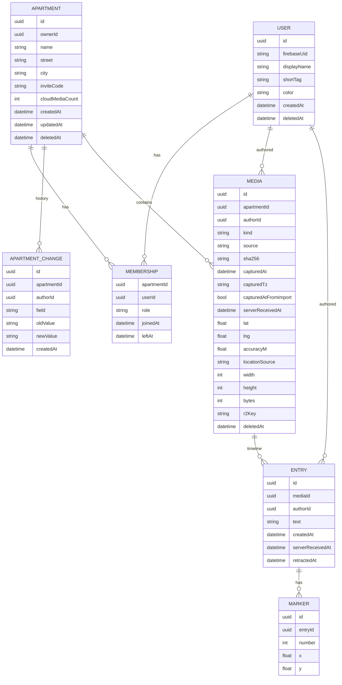
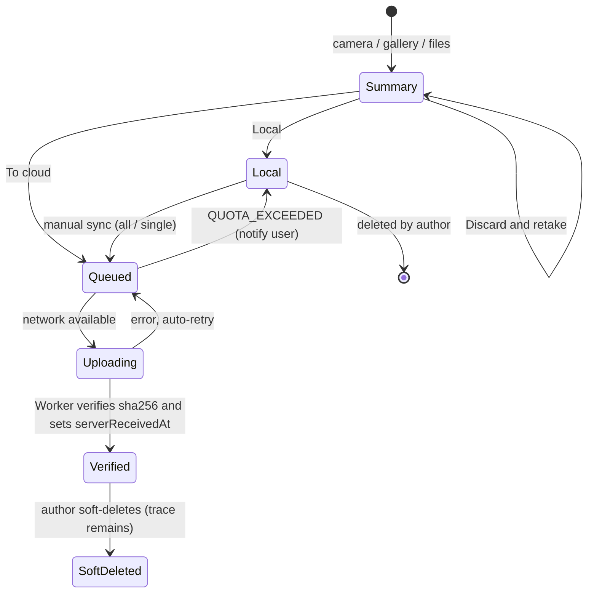

# StanMieszkania - Domain Design (MVP) v2

> Status: Agreed in 2 grill-me sessions (30 decisions). This document is the single source of truth before implementation. Session 2 overwrote part of Session 1 decisions (marked with `⟳`).

## 1. Product Purpose

StanMieszkania is an iOS application for tenants and landlords.
The application creates a dated, author-attributed, and immutable record of an apartment condition (photos and entries with markers).
This record helps resolve disputes when the tenant returns the apartment.
The MVP is free.
Paid features will be added later through StoreKit (IAP).

## 2. Glossary

| Term | Definition |
|---|---|
| **Apartment** | Property record with a user-defined name, street, and city. Metadata always synchronizes to the cloud. |
| **Owner** | Creator of the apartment (either the landlord or the tenant). The Owner manages the invite code and members. |
| **Contributor** | User who joined with an invite code. The Contributor sees all content and adds photos and entries. |
| **Invite code** | Permanent 8-character code (for example, `K7QM-4XPB`). The Owner can reset the code. |
| **Media (Photo)** | Compressed JPEG file that never changes after save. The client computes a SHA-256 hash. The `video` type exists in the model, but it is disabled. |
| **Entry** | Timeline item under a photo that contains text and 0 to N markers. The first entry is the summary description from the author. Both Owner and Contributor can add subsequent entries. |
| **Marker** | Semi-transparent dot at normalized coordinates `(x, y)` in range `0..1`. The marker has a global number `[n]` per photo and uses the author color. |
| **Local** | Stored only on the device. It displays no verification badge. |
| **V Verified** | Stored in D1 with `serverReceivedAt` and an author. Applies to both photos and entries. |
| **Source** | Either `Camera` or `Import` (gallery or files). A small icon near the date shows the source. |

## 3. Decision Register

### Domain and Evidence

| # | Decision | Consequences |
|---|---|---|
| Q1 | An apartment contains a flat list of photos on a timeline, without tags (Q13). | Fast MVP delivery. Sessions, rooms, and tags added later require migration and will not apply to older photos. |
| Q2 ⟳ | `V` means stored in the database (`serverReceivedAt` + author). The system also stores `capturedAt` and the SHA-256 hash computed at save time. | Simple and clear verification badge. Details view shows the second timestamp. |
| S2-12 | An icon indicates `Camera` or `Import` source. UI displays `capturedAt` for camera photos. UI displays EXIF date for imported photos, or import date with a note when EXIF is missing. Details view shows "Captured: ... / Saved in cloud: ...". | An old gallery photo cannot impersonate a new photo. |
| Q3 | The photo file never changes. Deleting a photo after upload performs a soft-delete visible to all members. | Preserves strong evidence. |
| S2-2 | The summary description becomes the first entry. All entries share the same data model. Marker numbers are global per photo and assigned by the server (temporary locally). Marker color identifies the author. | Prevents number collisions and shows who pointed to each defect. Client renumbers text during sync. |
| S2-3 | Users can edit or delete local entries freely. After sync, an entry is immutable, and only the author can retract it (leaving placeholder "Entry retracted by X, date"). Each entry has its own `V` badge. | Enforces the rule: edit locally, append-only in the cloud. |
| Q14 ⟳ | Markers are points with no count limit. Tapping a marker highlights the matching `[n]` in the entry text. Tapping outside clears selection. | Requires a custom lightweight SwiftUI editor. |
| - | No cropping is allowed. The summary screen provides "Discard / retake" above the photo. | The saved file matches the camera capture. |
| Q10 | GPS location is optional (via permission with explanation or EXIF), hidden in the UI, and stored only in the backend and future reports. | Collects evidence data now for future PDF reports. |

### Roles, Sharing, and Lifecycle

| # | Decision | Consequences |
|---|---|---|
| Q4 ⟳ | Owner and Contributor have equal rights for photos and entries. Both add photos and append entries (with markers) to any photo. No user can modify or delete another user's content. Only the Owner manages the invite code and members. | Provides symmetric evidence capabilities for both parties. |
| Q8/Q9 | Users join by entering a permanent invite code in the app (received by SMS or in person). The Owner can reset the code. Join attempts are rate-limited. | Simple onboarding flow. UX prompts the Owner to reset the code after a tenant joins. |
| S2-8 | Apartment metadata always lives in D1 and synchronizes in the background. Local-only state applies only to photos and entries. | Eliminates a "local apartment" state. Invite code becomes available after the first sync. |
| S2-9 | The Owner can edit the apartment name and address, and change history is visible to members. When the Owner deletes an apartment that has active Contributors, the Owner leaves and ownership transfers to the oldest active Contributor. Without active Contributors, deletion is permanent. A Contributor can leave at any time, and their contributions remain. | Shares the same ownership transfer logic as account deletion (Q5). |
| Q5 | Account deletion removes private user data. Contributions in shared apartments remain with an anonymized author. Ownership transfers according to S2-9. | Requires background jobs (Durable Objects Alarms). Revokes Apple Sign In and deletes the Firebase user. |
| S2-14 | Author identity comes from Sign in with Apple. When name is missing, the system displays `Użytkownik #A1B2`. No extra onboarding form is shown. Avatar displays initials on the author color. | Zero onboarding friction. Lower readability in disputes (see Section 6). |

### Sync, Storage, and Limits

| # | Decision | Consequences |
|---|---|---|
| Q6 | Local-first architecture using SQLiteData (updated in Architecture A13), client-generated UUIDv7, and an outbox queue. Local storage has no limit and always caches data. | Prevents data loss offline. |
| S2-7 | Choosing "To cloud" queues the item immediately (background `URLSession`, auto-retry, cellular allowed). Thumbnail shows a progress ring, then `V`. Choosing "Local" keeps the item offline. Manual sync provides "Sync all (N)" on the apartment and an action per photo. | Users do not wait for uploads. UI tracks all upload states. |
| Q7 | The client compresses photos to JPEG (~2-3 MB) while preserving EXIF before computing the SHA-256 hash. The uncompressed original is not uploaded. | Keeps cloud storage costs low. |
| S2-10 | R2 stores only the full JPEG without server-side thumbnails. The client downloads, downsamples, and caches images on disk. | Minimal backend complexity. Higher download transfer on a new device. |
| S2-11 | No push notifications and no "new" badges. On app launch and apartment open, the client queries changes since the last cursor and downloads updates with a loader. Pull-to-refresh is supported. | Standard pull sync model. No APNs required in MVP. |
| S2-4/5 | Cloud limit is 250 photos per apartment in a shared pool. Soft-delete does not free quota. `POST /media/init` enforces the limit and returns `QUOTA_EXCEEDED`. The photo stays local when quota is exceeded. | Controls storage costs. One party can fill the quota (rare). Limit is configurable for paid plans. |
| Q11 ⟳ | MVP is free with the 250-photo limit. Future monetization uses StoreKit 2 (for example, higher limits or paid PDF reports per apartment). | Per-apartment limit aligns with per-apartment purchases. |

### Technology and UX

| # | Decision | Consequences |
|---|---|---|
| Q12 | Firebase Auth with Sign in with Apple. The Worker verifies the ID token against Google JWKS using `jose`. | Single external auth provider. |
| Q15 | Cloudflare Workers (TypeScript + Hono), D1, R2 (presigned PUT/GET), and Durable Objects + Alarms (updated in Architecture A17). D1 and R2 run in EU jurisdiction. | Full backend runs inside Cloudflare. |
| S2-1 | Target iOS 26+ with SwiftUI, SQLiteData, and native Liquid Glass. | No legacy UI fallbacks. Devices without iOS 26 are unsupported. |
| S2-6 | Camera uses system `UIImagePickerController` one photo at a time, followed by summary, save, and return. Gallery (`PhotosPicker`) and Files (`fileImporter`) support multi-select with a pager on the summary screen. | Fast implementation. Capturing 30+ photos sequentially requires extra taps (see Section 6). |
| S2-13 | Single `NavigationStack` with no tab bar. Apartment view is a vertical day timeline (`17 listopada, czwartek`) with sticky day headers and day thumbnails. Zoom transition connects thumbnail and detail. Avatar in toolbar opens profile. Floating glass `+` button adds media. | Preserves chronological context and apartment history. |
| S2-15 | Polish UI only in MVP. All strings reside in String Catalog and dates use locale formatters. | Enables future English localization without code rewrites. |

## 4. Domain Model

Aggregates: `Apartment` (Membership, invite code, change history, quota counter), `Media` (Entry, Marker), and `User`. Theme (light, dark, or system) is a local device setting.

## 5. Domain Invariants

1. Photo bytes never change. The client computes `sha256` from the compressed JPEG before writing to disk. The Worker verifies the hash after upload.
2. Only the Worker assigns `serverReceivedAt`. A non-null `serverReceivedAt` grants the `V` badge.
3. Authors can edit and permanently delete local photos and entries. After cloud sync, authors can only soft-delete photos and retract entries so the audit trail remains visible.
4. Any active member can append an entry to any synced photo. No user can modify or delete another user's photos or entries.
5. Marker number `[n]` is unique within a photo. The server assigns final sequential numbers during entry sync. Local marker numbers are temporary, and the client rewrites `[n]` references in entry text after server renumbering.
6. `cloudMediaCount` (including soft-deleted photos) cannot exceed 250. `/media/init` enforces this check atomically.
7. An entry can target only a synced photo or the author's own local photo (in which case the entry uploads together with the photo).
8. Leaving an apartment or losing access blocks all reads and writes for that user. Contributions from former members remain visible.
9. Every apartment has exactly one active Owner. When the Owner leaves or deletes their account, ownership transfers to the oldest active Contributor, or the apartment is hard-deleted if none remain.

## 6. Accepted Risks

| Risk | Origin | Mitigation |
|---|---|---|
| 30+ photos at handover require 30 full capture cycles | S2-6 | Design the summary screen so burst mode can be added later without domain changes. Evaluate a secondary "Save and take next" button. |
| High bandwidth transfer on a new device | S2-10 | Lazy loading in timeline, local disk cache, and downsampling during decode. |
| `Użytkownik #A1B2` lacks clarity in disputes | S2-14 | Allow users to edit their display name in Profile without forcing it during onboarding. |
| One party consumes the entire 250-photo quota | S2-5 | Display an `X/250` counter on the apartment screen. Make the limit configurable. |
| Old invite code shared via SMS | Q9 | Rate-limit join attempts, prompt Owner to reset code after join, and allow revoking members. |
| No privacy control over apartment address | S2-8 | Provide a privacy policy and App Privacy labels. Store data in the EU. |

## 7. Photo and Entry Lifecycle

Photo upload flow:
1. Client calls `POST /v1/apartments/{id}/media/{mediaId}/init` (checks quota) and receives a presigned PUT URL.
2. Client uploads the JPEG file directly to R2.
3. Client calls `POST /v1/apartments/{id}/media/{mediaId}/confirm`. The Worker verifies the SHA-256 hash and sets `serverReceivedAt`. Pending entries from the outbox then upload.

Read flow:
`GET /v1/apartments/{id}/changes?after=cursor` returns metadata changes. Clients download image files through Worker-issued presigned GET URLs from the private R2 bucket after membership verification.

## 8. MVP Screens

1. **Onboarding**: Full-screen background video, short headline, one-sentence description, and Sign in with Apple glass button.
2. **Apartments List**: Glass cards showing name, street/city, and photo count. `+` opens "Create apartment" or "Join with code". Avatar opens Profile.
3. **Apartment Timeline**: Vertical day timeline with sticky day headers and thumbnails. Thumbnails show author avatar and status (`V`, progress ring, or local icon). Toolbar shows "Sync all (N)", `X/250` counter, Share (Owner), and Edit. Floating `+` opens Camera / Gallery / Files.
4. **Summary**: Header has "Retake / choose another". Photo supports marker placement (tap adds `[n]` to text). Description field, `DD/MM/YYYY HH:MM` date, and bottom action row (`Local` | `To cloud`). Multi-photo imports use a pager.
5. **Photo Detail**: Photo displays all markers in author colors. Entry timeline below shows author, role, date, and `V` badge. Tapping a marker highlights `[n]` and scrolls to the entry. "Add entry" supports text and markers. Shows capture and cloud timestamps plus source icon.
6. **Share (Owner)**: Displays invite code (copy, SMS, reset), member list, and access revocation.
7. **Profile**: Display name editor, theme selector, and "Delete account" with impact explanation and confirmation.

UX rules: Use system components with Liquid Glass, SF Symbols, haptics on save and marker placement, zoom transitions, spring animations, and Dynamic Type. Avoid decorative clutter.

## 9. Open Questions

- [ ] Add a secondary "Save and take next" button on the summary screen to mitigate S2-6?
- [ ] Define the exact contents of the future PDF report (first paid feature).
- [ ] Select the onboarding background video source (custom recording or stock).
- [ ] Allow an Owner to manually transfer ownership to an existing Contributor?
